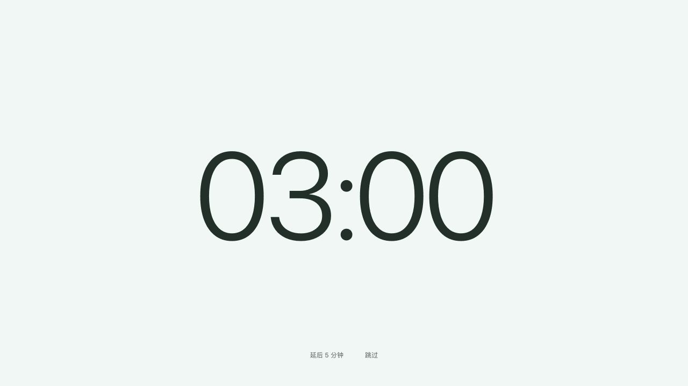

# v0.1.5 项目检查与修复

日期：2026-10-15。基于 v0.1.4 / 1ce81c7。版本已准备为 0.1.5，尚未发布安装更新。

## 已修复

| 范围 | 问题与修复 |
| --- | --- |
| 计时 | 延后 5 分钟按独立的完整周期计算总时长和进度；提前提示按当前周期长度判断；相邻工作时段视为连续工作，不吞掉临界提前提示 |
| 休息确认 | 手动暂停期间主动休息遇长空档，不再误计为完成；忽略已经结束轮次的失效窗口回调；正常退出只记一次中断 |
| 休息首帧 | 原生窗口准备期间显示请求时确定的休息时长，避免一开始闪现 45:00 工作计时；主进程确认展示后才开始倒计时 |
| 记录 | 新增兼容旧记录的 v2 计划／实际时长和独立延后结果；按事件 ID 与类型去重；损坏数据备份、保留合法条目、未来格式只读；记录故障不阻止提醒启动 |
| 自启动 | 系统拒绝注册或读取失败只影响自启动状态，不导致整个应用退出；真实状态可重试刷新；开发 Electron 不会注册为系统登录项 |
| IPC | 整份状态使用单调版本排序，迟到的初始快照不会把较新的自启动状态覆盖回旧值 |
| 更新 | 手动检查可加入后台检查并得到真实结果；下载等待在途检查，检查结果不能覆盖下载／安装状态；无效进度被忽略；异步安装失败保留已验证下载；退出后不处理迟到事件 |
| 标题栏 | 鼠标动作和键盘／无障碍点击用事件来源区分，不因 React 重渲染重复操作，也不吞掉下一次键盘点击 |
| 菜单／快捷键 | 菜单移到 portal，限制在视口中；支持方向键、Home／End、Esc 与返回焦点；休息开始时收起浮层；空格不劫持已聚焦按钮；自定义输入按钮保持单行 |
| 设置与错误 | 保存中锁定草稿，失败后保留编辑内容；快捷修改失败不丢弃输入；全屏休息和提前提示也能显示操作错误；更新提示操作失败有反馈 |
| 窗口 | 休息期间禁止设置尺寸变化重新弹出看板；窗口尺寸适配工作区；覆盖创建／热插拔异常进入统一失败处理；通知不可用不再导致未处理异常；看板渲染崩溃后可从托盘重新创建 |
| 开发隔离 | 开发运行使用独立数据目录；本轮原生检查使用临时目录，没有修改已安装版本的设置、登录项或运行进程 |
| 发布 | 新增 PR／main 的 Mac／Windows 自动检查；手动构建也检查不完整证书配置；发布前校验版本、架构、大小、SHA-512 与更新元数据；标记预发布，拒绝覆盖已公开版本的文件 |
| 文档与依赖 | 同步自启动默认开启、已有公开 Release、测试数及延后规则；移除陈旧的前端锁文件，以根 workspace 锁文件为唯一依赖来源 |

## 验证

- 本地 102 项测试通过：后台／发布脚本 74，前端 28，包含真实 React DOM 的交互和失败路径测试。
- TypeScript、独立前端及桌面生产构建通过；生产依赖审计 0。
- [Mac／Windows 自动检查](https://github.com/Jarden-1/remind/actions/runs/38691886616)均通过：锁定依赖安装、102 项测试、构建和生产依赖审计。
- Mac arm64／x64 的 DMG 和 ZIP 生成；更新元数据与四个安装器的 SHA-512 对应，两个应用包通过 codesign --verify --deep --strict。它们使用 ad-hoc 签名，不是 Developer ID／公证包。
- 隔离原生运行确认启动、双屏覆盖与 Esc 结束。两屏窗口及内容边界分别匹配 1920×1080 和 1512×982，结束事件保留同一个轮次 ID。最终生产页面再次确认休息首帧为 03:00，Esc 恢复看板，标题栏退出临时进程。
- 独立浏览器实测菜单显示、方向键选择、Esc 收起及焦点返回，设置标题居中、内容滚动。菜单宽 160px，确认按钮为单行；组件测试覆盖保存失败和全屏操作失败。
- 本次的物理锁屏／系统登录／热插拔全组合、连续 8 小时资源、Intel 真机和跨版本安装仍未完成。自动检查新增于修复分支，远端结果以 PR 检查为准。

## 休息页精简

按反馈移除装饰图形、标题、副文案、进度条、声音状态、全屏预览按钮和按钮边框。中央按最新反馈只保留超大倒计时，底部保留“延后 5 分钟”“跳过”两项文字操作，Esc 仍可结束休息。沿用浅色／深色令牌和等宽数字，保留可见键盘焦点。前端 28 项测试及完整生产构建通过，浏览器实测显示和 Esc 返回看板。

此处界面调整晚于上方安装包验证；发布前需从最新源码重新打包。

## 尚需外部条件的事项

1. **会议识别已实验性接入，真实会议验收待完成。** 两端辅助程序、确认与失败策略、权限入口已实现；不能把自动测试当作客户端兼容性证明，见 [会议接入说明](MEETINGS.md)。
2. **正式签名及完整 Mac 应用内更新需要开发者证书与公证配置。** 当前继续保留手动下载途径，未禁用系统签名验证。
3. **Windows／Intel Mac 系统验收与旧版升级**需要对应机器和实际安装，CI 构建不替代这些结果。
4. **构建依赖存在 8 项 moderate 报告。** 来源是 sprintf-js 的精度参数拒绝服务问题及传递依赖；其当前最新 1.1.3 仍在影响范围内，公告没有已修补版本。生产依赖未引入该链。本次没有强制降级打包器或伪造审计通过。[上游公告](https://github.com/advisories/GHSA-hp3w-g68c-fv3c)。
5. **桌宠玩法和奖励结算**仍属后续需求；已补数据基础，没有把 JSON 历史包装成可靠奖励账本。

会议接入后的本地检查：后台／脚本 89 项、前端 30 项，共 119 项通过；Mac 通用辅助程序自检及完整构建通过。另修复 fieldset 直接承担滚动时的浏览器布局问题，改用独立滚动容器，保存／取消固定在底部。新界面与会议实现尚未生成安装器，真实会议需用户授权后验证。

## 前端与交互打磨

- 看板缩为 368 × 440，放大居中计时，统一节奏菜单、按钮和深浅色。删除底部铃声／工作时段栏，“现在休息”替换为“重置时间”，删除重复重置图标；相关选项保留在设置。
- 提前提醒精简为 260 × 56 单行，无图形、副文案和进度条；5 秒自动关闭，继续保留一分钟的提前量。两端时钟测试验证关闭后不重发、不推迟到期休息，浏览器实测无需点击即消失。
- 自定义分钟输入校验、选中标记、保存中禁用和失败保留；Tab 可进入输入区，成功与取消返回焦点。菜单尺寸变化后重新定位。
- 设置错误显示在对应字段旁，保存聚焦首个错误；支持键盘保存和取消，外观即时预览、取消恢复；工作时段最多 12 个。设置滚动不再带动外层页面，短桌面窗口保持操作可达。更新操作改为独立行，长文案不会挤压按钮。
- 辅助功能入口在用户点击时调用系统授权流程并跳转对应设置，减少误选应用；仍由用户授权，返回后根据实际探测状态判断。
- 127 项测试通过（90 + 37），类型检查、前端与桌面构建、Mac 通用辅助程序自检通过。隔离桌面运行验证新看板、设置切换、Esc 返回、开始／重置和正常退出；没有修改已安装应用或再次进行真实会议测试。

## 已审核界面落地（2026-10-16）

- 用户选定「同宽操作」，保留原分段刻度。主次按钮同宽、40px 同高、间距 12px，时长行与操作固定间距 24px；移除操作图标与常驻灰底。
- 看板默认高约 378px，按真实内容自适应；窗口受工作区限制时内部滚动。内容变化不唤醒隐藏窗口，Windows 保持底部锚点。
- 设置改为标签左齐、输入／开关右齐的行布局；工作时段关闭后收起明细，错误时展开聚焦，日期快捷项继续保留自定义时间。
- 131 项测试通过（后台／脚本 93、前端 38），类型检查、前端及桌面生产构建、Mac 通用会议辅助程序自检通过。

