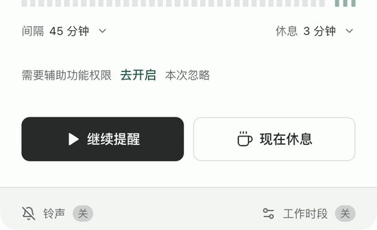

# 会议自动暂停

2026-10-16 · v0.1.6 实验功能，默认关闭。先接入腾讯会议、飞书桌面客户端；浏览器会议不在本轮范围内。

## 行为

- 设置中开启并保存后开始检测；关闭即停止。锁屏／休眠期间不检测，恢复后重新检查。
- 原生模块只读允许的软件的会议操作控件。结束／离开控制与麦克风、摄像头或共享操作共同出现才判定为会中，不把运行进程、麦克风占用或声音大小单独当会议。
- 腾讯会议 3.46 的 Qt/NX 界面部分按钮无标准标签，另匹配明确的会中页面标识；排除会前、候会室和结束确认页。此匹配来自本机客户端资源与辅助功能标识的核对，仍需真实入会验证。
- 开始信号持续至少 5 秒确认，结束需连续有效的未在会议状态持续 30 秒。腾讯和飞书各自维护状态，不能因其中一个结束就解除另一个。
- 会议确认后收起提前提示／休息窗口，显示软件名，发一次静音提示。会议结束重新计满工作间隔，保留手动、工作时段及系统暂停。
- 检测失败不算会议结束。已在会议中则继续暂停；连续失败两分钟显示“会议状态待确认”，允许“本次忽略”。未确认过会议时继续工作计时，但到期和展示前再次检测，仍不确定则本轮仅静音通知，重新计满间隔。
- “本次忽略”在有效会议结束后失效，下一场会议继续自动暂停。显式“现在休息”可覆盖未确认状态，不能覆盖已确认会议。
- 权限不足时，看板优先提供“去开启”，直接打开系统辅助功能授权页；“本次忽略”是次要选项。返回看板后重新探测，只在读到真实授权结果后移除权限提示，打开设置本身不会被当作已授权。

## 平台与权限

| 平台 | 实现 | 权限与限制 |
| --- | --- | --- |
| macOS 14+ | Swift 动态库＋稳定 Node-API 模块，arm64+x64 通用二进制，在应用进程的后台线程运行 | 权限对应 remind 本身，避免独立辅助进程身份差异；以实际 AX 授权或允许软件的成功受保护读取确认，不因打开设置而假定授权 |
| Windows x64 | 独立 C# 程序，公开的 .NET UI Automation | 不请求管理员权限；不同完整性级别、未提供辅助功能树的客户端返回 unknown |

不录音、不截屏、不读取聊天内容或参会人；原始控件标签、窗口标题和进程命令行不会写入 IPC、日志、记录或网络。仅输出有限的应用标识、状态与可选版本号。Mac 扫描预算 2.3 秒，每次 AX 消息超时 0.1 秒，不阻塞界面线程；Windows 子进程强制三秒超时、输出最多 16 KiB。没有 shell 命令拼接，不重叠探测，退出或关闭后忽略迟到结果。

Mac 的 ad-hoc 签名不能保证替换应用后沿用旧授权。系统设置中旧条目处于开启状态，不等于当前二进制已获得有效授权；必要时需由用户移除旧条目并重新添加当前应用。本程序不修改 TCC 数据库或自动授予权限。

## 验证状态

- 已增加判定去抖、双应用、失败保持、权限丢失、忽略恢复、休眠空档、关闭／退出迟到响应、主计时集成与 IPC 回归测试。
- Mac 通用原生模块编译及内置分类器自检通过，扫描在异步工作线程运行；生产页面在权限不足时显示明确状态。本轮没有修改系统授权。
- 权限入口补充后共 121 项本地测试通过（后台／脚本 89、前端 32），完整构建通过。实际点击已确认定位到 macOS 辅助功能授权页；返回后的检测、失败反馈和重试由交互测试覆盖，没有修改系统授权。
- Windows 辅助程序由 Windows CI 编译并执行相同分类器自检。
- **真实入会、静音、最小化、屏幕共享、结束后恢复，以及 Windows 真机均需客户端验收。当前不能宣称全部组合已稳定支持。** 腾讯会议主页已核对，实际会中标识及飞书控件仍需真机验证。
- 本轮先完成功能和检查，再统一构建安装器；暂不把实验识别当作稳定发布。

## 参考与选择

使用系统公开的 [Apple Accessibility API](https://developer.apple.com/documentation/applicationservices/axuielement) 和 [Microsoft UI Automation](https://learn.microsoft.com/en-us/dotnet/framework/ui-automation/ui-automation-overview)。参考 [meeting-transcriber 的检测边界](https://github.com/pasrom/meeting-transcriber/blob/a4f6af6df2674bc4e18097084a128af469823fab/app/MeetingTranscriber/Sources/MicInputDetector.swift)，没有复制其录音或音频采集实现。

本轮没有采用“麦克风在用即开会”的方案，避免飞书语音消息／入会预览误判，也不依赖静音时持续占用输入。UI/控件方案同样受客户端版本影响，因此保留 unknown、手动覆盖和明确的实验标记。最低系统与两个客户端的支持矩阵应由安装版实测补齐。

