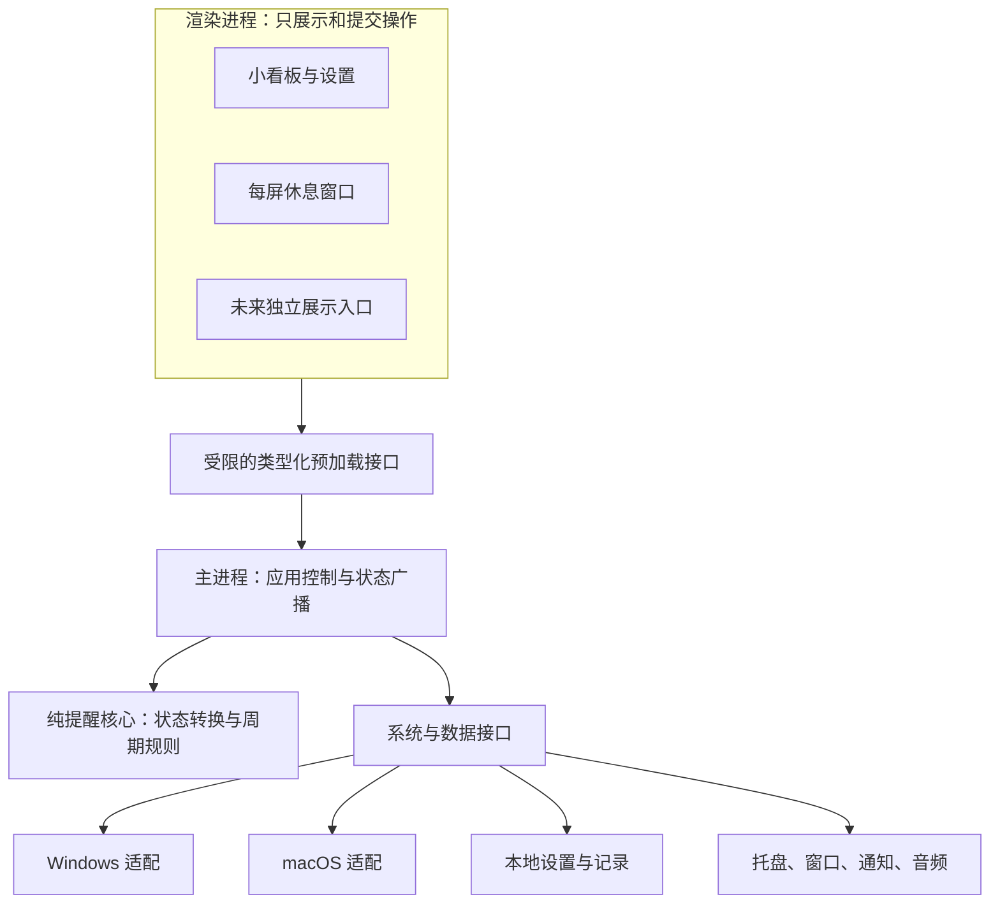

# Remind 技术设计

版本：0.3 草案 · 日期：2026-10-12（北京时间）

状态：已接入基础桌面后台和用户主动更新；当前目录、依赖与验证边界见 [桌面后台说明](DESKTOP.md)。本文仍包含后续设计，不能视为所有系统能力均已验收。产品行为以 [SPEC](SPEC.md) 为准；默认休息 3 分钟且可自定义、提前 1 分钟提醒、支持工作时段已确认；D01–D16 中其余建议待用户审核。

## 1. 技术结论与决策依据

首选 **Electron + React + TypeScript + electron-vite**，本地单应用，不建立 HTTP 后端、不启动本地 Web 服务、不引入云端。

优先使用成熟构建、存储、日志和打包组件；参考 Stretchly 的系统边界实现。自行编写的核心仅包括本产品状态规则、操作协调，以及现成项目不能覆盖的中国会议软件适配。

| 决策 | 当前选择 | 理由与限制 |
| --- | --- | --- |
| 桌面运行时 | Electron，技术验证后冻结 | 窗口、托盘、电源事件已有能力；常驻开销必须测量 |
| 界面 | React + TypeScript | 小面板及休息画面共用组件，未来可增加独立展示入口 |
| 开发构建 | electron-vite 的稳定版本、react-ts 模板 | 不自建主进程／预加载／渲染构建流水线；模板默认项需要调整 |
| 打包 | electron-builder 稳定版本 | 复用 Windows 安装包、Mac DMG、签名和发布能力 |
| 设置与小量记录 | electron-store，经仓储接口访问 | 现成原子写入及 schema 支持；数据量受限，不每秒写入 |
| 日志 | electron-log，本地轮转 | 不自建日志框架，不上传用户活动信息 |
| 计时与暂停 | 独立 TypeScript 领域模块 | 不与窗口、数据库和会议探测耦合 |
| 会议检测 | 独立平台探测器，必要时小型原生辅助程序 | Electron 没有直接给出腾讯／飞书实际会话状态的通用 API |
| 测试 | Vitest 验证状态核心，少量桌面集成测试和真机矩阵 | 自动测试无法证明系统覆盖和外部会议客户端兼容 |

### 1.1 为什么不直接整体 fork

Stretchly 与基础需求接近且许可证适合选择性复用，但同时包含微休息、长休息、想法内容、多种排除与大量设置。其核心存在对日志、设置和监测器的直接依赖，整体 fork 后并不自然满足本项目的独立状态核心及小看板目标。

因此采取“成熟脚手架 + 选择性适配 Stretchly 系统实现”的路径。对多屏等已解决的问题先查上游，再实现必要差异；不是另写一套通用休息工具框架。

如果验证发现窗口逻辑可以直接抽取，会保留原始授权、源码来源和适配说明；不会为了保持原创而重写相同实现。

### 1.2 Tauri 的位置

Tauri 为候选，不与 Electron 同时维护。它采用系统 WebView；macOS 透明窗口的配置存在私有 API 与商店限制。Electron 同样有平台窗口限制，透明能力也不等于跨平台零问题。[Tauri WebView](https://v2.tauri.app/reference/webview-versions/)、[透明窗口配置](https://v2.tauri.app/reference/config/#transparent)、[Electron BrowserWindow](https://www.electronjs.org/docs/latest/api/browser-window/)

选择 Electron 的前提是基础样机达到资源目标、窗口行为通过验证。若失败，先分析窗口常驻、探测频率与依赖问题；仍不能接受才以同场景样机比较 Tauri。本文没有完成性能基准，不能声称任一框架实测更省内存。

### 1.3 相对前期讨论的收敛

前期提出过直接采用 SQLite。当前基础版仅需设置和有限休息记录，先复用 electron-store，避免提前承担原生数据库模块打包与迁移负担。数据接口及版本现在定义清楚，养成或大量历史出现时再引入 SQLite；不把通用 SQL 查询泄漏给界面和核心。

这是实现方式调整，不改变本地保存和可扩展的产品方向。electron-store 官方明确它适合小数据、每次变更重写整个 JSON，不能作为无限历史数据库。[官方说明](https://github.com/sindresorhus/electron-store)

## 2. 进程、模块和依赖方向



主进程是运行状态的唯一所有者。渲染进程不能自己开始下一轮、判断会议结束、直接修改文件或执行系统命令。

会议探测在独立辅助程序或受控工作单元中运行，有超时、退出和重启边界；不得阻塞 Electron 主线程。基础版不为小型纯计算另起服务。

### 2.1 建议目录

以下是完整桌面端的建议组织。当前先行开发的前端独立位于 `frontend/`，使用 Vite + React + TypeScript；组件通过 `ReminderClient` 契约订阅快照、发送命令，本地模拟适配器可整体替换。正式接入桌面端时，计时与系统能力归入主进程，不能把模拟适配器作为后台核心运行，也不能同时保留两套计时。开发用本地预览服务器不属于正式桌面运行架构。

```text
src/
  domain/reminder/        # 状态、纯转换函数、规则；不 import electron/react/fs
  application/           # 操作队列、计时调度、提前提示、工作时段与事件协调
  contracts/             # IPC DTO、校验 schema、公共事件类型
  main/
    bootstrap/           # 单实例、启动/退出、组件装配
    windows/             # 面板与每屏休息窗口生命周期
    tray/                # 托盘与原生菜单
    adapters/
      power/             # 休眠、锁屏、恢复
      meetings/          # 共用判定、Windows/Mac 探测器
      persistence/       # electron-store 仓储
      notifications/     # 静音状态提示
      audio/             # 单次铃声协调
  preload/               # 明确的业务 API，不导出通用 ipcRenderer
  renderer/
    panel/               # 看板与设置
    break/               # 休息入口
    shared/              # 样式、字体、基础控件
native/                  # 验证后需要的最小平台探测实现
tests/
  domain/
  integration/
  manual/                # 真机验证记录与支持矩阵
docs/
```

一个仓库、一个桌面工程即可，暂不需要多包 monorepo、微服务、通用插件框架或全局消息中间件。

## 3. 提醒核心模型

### 3.1 状态与原因分离

```ts
type Phase = 'waiting' | 'preparingBreak' | 'breaking';
type PauseReason =
  | 'manual'
  | 'systemLocked'
  | 'systemSuspended'
  | 'outsideSchedule'
  | `meeting:${string}`
  | 'meetingNeedsConfirmation';

interface ReminderState {
  phase: Phase;
  pauseReasons: ReadonlySet<PauseReason>;
  remainingWorkMs: number;
  resetOnResume: boolean;
  cycleId: string;
  generation: number;
  preReminderSent: boolean; // 同一 cycleId 最多一次
  activeBreak?: {
    id: string;
    plannedDurationMs: number;
    elapsedVisibleMs: number;
    manualStart: boolean;
  };
}
```

这是概念类型，不是已有实现。对外 DTO 将 Set 序列化为数组；内部时钟锚点不暴露为可由界面改写的状态。

有暂停原因时不累计工作时间。手动触发的休息是例外：仅存在 manual／outsideSchedule 原因时可运行休息倒计时，完成后仍保留这些原因；存在系统、会议或待确认原因时不能开始覆盖。

自动暂停将 `resetOnResume` 设为 true。只有相关原因被移除、所有暂停原因均解除时才消费这个标记并重新计满间隔。重复系统事件不重复重置；`resume` 不清除 `systemLocked`。

### 3.2 关键转换

| 当前情境 | 输入 | 核心输出 |
| --- | --- | --- |
| waiting，无暂停 | 工作时间到期 | preparingBreak，发起窗口准备 |
| waiting，无暂停 | 提前 60 秒的提示点到期 | 本轮尚未提示且休息会落在工作时段内时，发出一次轻提示，不切换 phase |
| preparingBreak | 本代窗口就绪且复核通过 | breaking，统一开始休息时钟 |
| preparingBreak | 暂停／会议／锁屏 | 取消准备，销毁窗口，忽略过期就绪回调 |
| waiting | manualPause | 保存剩余时间，增加 manual |
| waiting，仅 manual | manualResume | 移除 manual；若有 resetOnResume 则重置，否则继续剩余时间 |
| waiting／breaking | meetingStarted(appId) | 添加该应用原因，标记重置，必要时中断休息 |
| 有会议原因 | meetingEnded(appId) | 仅删除对应原因，保留其他暂停；全部解除后重新计时 |
| waiting／breaking | scheduleClosed | 添加 outsideSchedule、标记重置、撤下轻提示；当前休息记为 interrupted/schedule |
| 有时段原因 | scheduleOpened | 仅清除 outsideSchedule；无其他原因时开始完整间隔 |
| breaking | breakFinished | 记录 timed_out，收起窗口，开始新间隔或保持原暂停 |
| breaking | endEarly／Esc | 记录 ended_early，收起窗口，开始新间隔或保持原暂停 |
| breaking | lock／suspend／pause | 记录 interrupted，收起窗口，进入相应暂停 |
| 任意情境 | 旧计时回调、旧窗口确认、重复结束 | 依据 generation、cycleId、breakId 丢弃 |

所有控制事件进入一个串行处理入口。到期前和窗口显示前复核暂停原因；同一批事件中系统／会议暂停优先于展示副作用。系统尚未提供的会议信息无法被“零竞态”保证，检测延迟需在支持报告中记录。

### 3.3 调度与时钟

- `MonotonicClock` 负责进程内经过时间；`WallClock` 只负责记录时间和用户可读的下一次时间。
- 暂停时先结算有效经过时间，恢复时建立新锚点；不通过累计每秒 tick 计时。
- `setTimeout` 仅负责唤醒检查；回调再次核对时间、generation 和暂停状态。
- 由一个调度器维护当前最近的有效期限：提前提示、工作／休息截止、工作时段边界。不同类型通过 generation 和 cycleId 校验；不各自启动互不协调的循环。可见界面每秒根据快照刷新，隐藏后不持续渲染。
- 短时进程阻塞导致过期时只触发一次，不按错过的周期补发。
- 系统挂起、锁屏事件直接取消调度；恢复后重新核对锁屏状态及会议检测，再按 SPEC 重置。
- 单调时钟跨休眠的行为不能替代系统事件；对长回调间隔执行系统状态复核。若无法区分长阻塞与漏报休眠，进入安全重置并留下诊断码，不立刻全屏。
- 更改系统日期／时区不直接改变持续时长，但必须按新本地时间重新判断工作时段，必要时触发时段暂停／重置；不持久化旧单调时钟值供下次进程使用。

### 3.4 提前提醒与工作时段

提前提示是计时副作用，不是新的休息状态；默认提前量固定 60 秒，是否支持更改以后再定。每个 cycleId 记录是否已发送，手动暂停继续同一轮不重复；重置工作轮次才清除此标记。手动休息、工作间隔 ≤60 秒、过期补发、暂停状态均不发送。

轻提示建议使用按需创建的无焦点小浮层，显示后自动收起；只在用户当前操作的屏幕显示一次，不重复到每块屏幕，也不复用全屏休息窗口抢焦点。暂停／取消时由主进程主动销毁；进程回调失效检查同样适用。休息铃声设置不作用于提前提示。

工作时段用纯函数 `evaluateSchedule(localNow, config)` 输出当前资格、当前时段结束、下次开放边界，不依赖会议探测器。配置建议为 enabled、weekdays（ISO 1–7）和 dailyRanges（HH:mm 开始／结束）；采用 [start, end) 区间。多时段不重叠，跨午夜和不同日期独立排班暂为待审扩展。

时段限制关闭时全天有资格，仍遵守其他暂停原因。初始启动、唤醒、系统时区／时间变化、修改配置、边界到期时均重新求值；没有系统时间变更事件的平台以低频复核补充，不每秒写盘或遍历系统窗口。

下次休息落在当前时段结束时刻或之后，不调度本轮全屏或提前提示，看板返回 `nextBreakAt: null` 和“本时段不再提醒”，等待下一工作时段。进入下一时段从完整间隔开始，不承接午休前欠下的计时。临界时间同批到期时，时段关闭优先于提前提示和休息展示。

修改配置创建新 generation，废弃旧边界／提示回调，并按 SPEC 重置。时段开始只能解除 outsideSchedule，不能解除 manual 或 meeting。工作日、跨午夜、时区和夏令时以系统本地日历重新求值，不以固定 24 小时毫秒相加计算“明天”。

对待恢复状态设独立的 `recoveryPending` 抑制展示，防止唤醒事件到达而锁屏结果尚未更新时出现窗口。抑制要有超时与可见故障状态，不能永久隐藏暂停。

## 4. 窗口与系统适配

### 4.1 小看板

复用 Electron Tray、原生 Menu、screen API。定位由托盘 bounds、当前显示器 workArea 和缩放决定；处理负坐标、任务栏位置变化与 Mac 菜单栏边缘，不使用固定右下角坐标。[Tray](https://www.electronjs.org/docs/latest/api/tray)、[screen](https://www.electronjs.org/docs/latest/api/screen)

普通面板隐藏后停止界面定时更新，核心继续运行。可复用隐藏窗口以减少反复创建成本，是否销毁以资源测量决定。设置编辑期间明确保存／取消，不因失焦丢失。

### 4.2 休息覆盖

- 一个显示器对应一个无边框、不透明、按 display.bounds 覆盖的窗口。
- 覆盖窗口关闭原生圆角、阴影和 Windows thickFrame；Mac 启用 enableLargerThanScreen，绕过菜单栏边界裁切。显示后重设并核对窗口及内容边界，直接使用 DIP，不额外乘缩放系数。对应屏幕的坐标变化、旋转、缩放沿用同一流程。[Electron 窗口接口](https://www.electronjs.org/docs/latest/api/base-window)
- 休息时隐藏小看板；重新激活应用聚焦当前屏幕的休息窗口，避免看板浮到覆盖层上。结束后仅恢复原本打开的看板。
- 不默认使用 kiosk，也不强制禁止系统切换；目标是明确提醒和可退出。
- 在 Mac 优先验证“覆盖窗口 + 允许显示于全屏应用所在空间”，避免进入新的系统全屏 Space；若不可行，再比较受控全屏实现。
- 主进程统一生成 breakId 和休息时钟；各窗口只读同一份状态。
- 准备期间窗口隐藏。等待全部目标窗口就绪并复核状态后再显示；计时从成功展示开始，而不是从加载页面开始。
- 准备超时建议 5 秒：取消本轮全部窗口，记录 display_failed，静音通知兜底；工作轮次重新计满间隔，故障状态持续可见。不在故障循环中每秒重建窗口。
- 多屏只允许一个窗口获得键盘焦点，保证 Esc 可用；其他屏可点击退出。关闭时尽力恢复先前焦点。
- 插拔、旋转和缩放事件使窗口布局重新协调，新窗口沿用本轮剩余时间，不重新播放铃声，不新增休息记录。
- 任意窗口关闭由协调器完成整轮退出，避免残留置顶窗口。
- 托盘“结束休息”作为额外退出途径；窗口崩溃不能导致输入被锁住。

Stretchly 提供了多屏和平台分支的参考，但其 kiosk 与全部工作空间逻辑不能混合照搬。要按固定源码版本核对注释与行为。[调研细节](OPEN_SOURCE_RESEARCH.md#3-stretchly优先参考的基础实现)

### 4.3 系统生命周期

复用 `powerMonitor` 的 suspend、resume、lock-screen、unlock-screen，配合系统状态查询。监听和清理必须成对，防止重建组件后重复订阅。[官方接口](https://www.electronjs.org/docs/latest/api/power-monitor)

单实例使用 `app.requestSingleInstanceLock`；二次启动只打开已有看板。关闭全部窗口不等于退出应用；退出命令取消调度、停止探测器、保存状态并销毁所有窗口。

开机启动优先使用 `app.setLoginItemSettings` 与读取实际系统状态；只有验证发现打包环境不满足时再评估 auto-launch，不同时维护两种设置来源。[官方 app 接口](https://www.electronjs.org/docs/latest/api/app)

### 4.4 音频与通知

铃声由统一音频适配器接收本轮开始命令，仅一个输出端播放一次，不能由每个显示器分别播放。静音、关闭窗口或中断都停止音频；播放失败不阻碍提醒。内置音频需有明确授权。

会议提示通过静音系统通知发出；托盘与小看板为持久状态来源。系统免打扰可能拦截通知，API 调用成功不能作为用户已看到的证据。

## 5. 会议识别

### 5.1 公共接口

```ts
interface MeetingSnapshot {
  status: 'active' | 'inactive' | 'unknown' | 'unsupported';
  observedAt: string;
  sessions: Array<{
    appId: 'tencent-meeting' | 'feishu';
    sessionKey: string;
    evidence: Array<'audio-input' | 'meeting-window' | 'platform-session'>;
  }>;
  diagnosticCode?: string;
}
```

未知不等于未开会，空列表必须与探测成功状态一起解释。软件支持状态独立返回；部分适配器失败时不能误判全部会议结束。

每个适配器记录平台、客户端版本、探测器版本、权限状态与验证日期。进程 PID 不是长期会议 ID；需要处理 PID 重用、辅助进程迁移及断线重连。

### 5.2 macOS 路径

优先参考 MIT 的 meeting-transcriber 中 `MicInputDetector`、对应测试和软件映射；该项目已有腾讯会议规则。side-huddle 提供底层 Core Audio 查询及入会预览过滤的参考。

只提取必要元数据能力，不引入录音、转写、模型、浏览器扩展或网络集成。优先以独立 Swift 辅助程序接入，定时返回有限 JSON；不为了复用一段 Rust 查询引入完整录音引擎。

API、SDK 和系统最低版本在技术验证中逐一核对；使用运行时可用性检查，旧版本返回 unsupported，不能把整个应用安装门槛与某个探测接口混为一谈。[Apple Core Audio 属性](https://developer.apple.com/documentation/coreaudio/kaudioprocesspropertyisrunninginput)

腾讯会议已存在源码参考不等于静音监听全覆盖。飞书的实际音频所属进程、辅助进程、语音消息和入会预览需要采样验证，不能只加入 bundle ID 后宣布完成。

窗口标题只能作为辅助信号：权限与多语言会影响可用性。`get-windows` 可作为备选库，实际 npm 包名已由 active-win 更名而来；未验证其必要性前不默认索取屏幕录制／辅助功能权限。

### 5.3 Windows 路径

优先验证 Windows Core Audio 的输入端点音频会话、会话事件和所属 PID，并关联允许的软件及会议窗口。官方说明单独依赖 session enumerator 可能不完整，因此需要会话通知或重建枚举等机制，不把一次采样当完整状态。[Microsoft 文档](https://learn.microsoft.com/en-us/windows/win32/api/audiopolicy/nf-audiopolicy-iaudiosessionmanager2-getsessionenumerator)

BreakTime 的 ConsentStore 注册表方案可作为实验性补充，不能当稳定公共会话 API；其上游实现把任意麦克风／摄像头使用视为会议，不适合原样采用。需排除录音机、摄像头预览、飞书语音等非会议活动。

建议最小原生辅助程序采用 C++／Win32，输出与 Mac 相同的 JSON 契约；是否直接复用现成 Node 原生模块取决于维护状态、授权、签名和打包验证。当前未发现已核验的、可直接覆盖两平台腾讯与飞书全部状态的成熟通用组件。

### 5.4 判定、频率和失败策略

- 原始探测器返回证据，公共判定层做去抖和状态转换，领域核心只接收已确认的变化。
- 初始探测间隔建议 2 秒，开始确认 5 秒、结束确认 30 秒；检测中不启动重叠调用。
- 关闭自动识别时完全停止探测；锁屏／休眠暂停探测；手动暂停时降低频率但保留必要状态，防止恢复时立即打断会议。
- 每次调用建议 3 秒超时；超时、异常退出、权限变化都输出 unknown，不能映射成 inactive。
- 已 active 时失去证据与探测失败分别处理。静音不应单凭音频振幅为零判定结束；不采集音频样本。
- 已知会议状态故障最多重试 2 分钟，之后保持可见的 meetingNeedsConfirmation，等待用户继续或有效结果恢复。有效 inactive 恢复后自动清除故障原因，仍遵守其他暂停原因。
- 未在会议中而检测不可用时继续工作计时；到期仍 unknown 时按 SPEC 降为一次静音通知，记录 detector_unknown，本轮不算完成休息，重启完整工作间隔。用户关闭自动检测后恢复正常全屏行为。
- “本次忽略”用会话级 suppression 标识；有效会议结束后清除，不设永久全局绕过。探测故障时明确显示忽略状态，并允许关闭自动检测。

辅助程序使用标准输入输出的带版本 JSON 协议，固定二进制路径，无 shell 拼接；超时可终止、异常可有限退避重启。记录错误码和必要软件标识，不记录窗口标题、完整进程命令行或会议内容。

## 6. IPC 与安全边界

预加载仅暴露 `getSnapshot`、`subscribeState`、`pause`、`resume`、`startBreak`、`endBreak`、`updateSettings` 等明确业务操作。订阅返回取消函数。

- `nodeIntegration: false`、`contextIsolation: true`、`sandbox: true` 明确配置。
- 主进程验证消息来源窗口、数据类型、范围及当前状态；breakId、requestId 防止过期结束和重复命令。
- 状态广播带 revision，窗口丢弃旧快照；订阅建立后再取快照，通过 revision 消除初始化竞态。
- 不暴露通用 IPC send、执行命令、读写任意文件或任意打开 URL 的能力。
- 生产仅加载本地资源，设置 CSP；禁止任意新窗口与远程导航，帮助链接用 HTTPS 白名单。
- 主进程不信任 renderer 的倒计时或“已完成”声明。

react-ts 模板及部分参考应用在核对版本中使用 `sandbox: false`，模板还导出较宽的 Electron preload API；初始化时必须收窄。复用脚手架不意味着其默认配置适合本产品。[Electron 隔离说明](https://www.electronjs.org/docs/latest/tutorial/context-isolation)、[沙箱说明](https://www.electronjs.org/docs/latest/tutorial/sandbox)

## 7. 数据设计与恢复

### 7.1 存储接口

主进程单独持有设置和记录仓储。界面及核心不读取 electron-store；只通过应用控制接收数据。

设置字段建议：schemaVersion、workIntervalMinutes、breakDurationMinutes、preReminderEnabled、soundEnabled、launchAtLogin、meetingAutoPauseEnabled、meetingApps、theme、manualPaused、hasStartedBefore、workSchedule（enabled、weekdays、dailyRanges）。

当前倒计时不每秒落盘。持久化手动暂停意图和 activeBreak 标记，应用重启统一从完整间隔开始。开机启动读取系统真实结果后再更新展示，不能只显示配置中的愿望值。

### 7.2 休息记录

```ts
interface BreakRecord {
  schemaVersion: 1;
  id: string;
  cycleId: string;
  trigger: 'scheduled' | 'manual';
  startedAt: string; // UTC ISO 8601
  endedAt: string;
  plannedDurationMs: number;
  visibleDurationMs: number;
  outcome:
    | 'timed_out'
    | 'ended_early'
    | 'interrupted'
    | 'display_failed'
    | 'detector_unknown';
  interruptionReason?: 'manual' | 'meeting' | 'lock' | 'suspend' | 'schedule' | 'quit' | 'crash';
}
```

展示前失败和检测降级记录的 visibleDurationMs 为 0。每个 breakId 只写一个最终结果；时间戳用于展示，时长依据进程计时。崩溃恢复时对遗留 activeBreak 写入 interrupted/crash，不推断崩溃后还在休息。

设置和有限记录使用不同文件，避免记录损坏使全部设置丢失。记录建议上限 500 条、90 天，并设文件大小上限；只在休息起止等业务边界更新，不做持久化事件溯源。

数据无法保存时提醒核心继续可用，并显示存储故障；UI 不显示“已保存”。未来涉及经验奖励时，需改用可事务、幂等的结算存储，不能把当前内存事件总线当可靠奖励账本。

### 7.3 迁移及故障恢复

- 各文件保留 schemaVersion，迁移顺序明确、可重复运行。
- electron-store 的内置 migrations 在上游有已知问题说明，使用显式版本转换与备份，不把内置迁移当可靠性保证。
- 迁移前保留最近可恢复备份；未知的更高版本只读并提示，不自动覆盖降级。
- JSON 损坏先保留原文件，再尝试备份；失败时使用默认设置并提示。
- 配置校验只接受范围内字段，拒绝 NaN、负数和异常大输入。
- SQLite 切换时保持仓储接口与 record id；先备份、导入、核对数量及版本、原子标记完成，保留旧文件直到验证成功。
- 用户清除记录不会改变计时和设置。

## 8. 未来扩展的最小预留

预留 `break.started`、`break.ended`、`reminder.pauseChanged` 等带版本的应用事件，以及独立的窗口展示入口。事件由核心状态转换后产生，订阅者不能反向操纵核心内部状态。

未来桌宠可订阅事件并通过同一受限 API 发出用户操作。当前不创建桌宠窗口、动画循环、宠物数据表、奖励规则或素材包系统，也不提前引入 PixiJS／Live2D／Three.js。

模块边界提供扩展空间；真正的游戏存档事务、素材授权和分发机制等，等玩法明确后再设计。

## 9. 性能目标与验证门槛

以下是建议验收目标，尚无本项目实测结果。

| 指标 | 初始目标 | 测量方法 |
| --- | --- | --- |
| 后台 CPU | 无可见窗口、会议识别关闭时，平均 ≤ 单个逻辑核心的 0.5% | 打包生产版，稳定后观察 30 分钟，声明工具和硬件 |
| 常驻内存 | 相同场景进程树 RSS／Working Set 总和目标 ≤ 200 MiB | 分平台报告主进程、renderer、GPU、helper；不同平台不可直接当同口径比较 |
| 会议探测成本 | 单独报告开启前后的 CPU、内存及唤醒变化 | 软件未运行、运行未开会、开会三种状态各测 |
| 到期延迟 | 正常非休眠情况下展示目标误差 ≤ 2 秒 | 生产包连续至少 20 轮短周期；不靠开发模式测量 |
| 面板打开 | 热打开目标 ≤ 300 ms | 从点击到可交互；冷启动另记 |
| 长时稳定性 | 至少 8 小时，无计时重复、残留窗口或持续增长 | 包含暂停、开会、休眠、插拔显示器 |
| 安装包体积 | 先测基线，不承诺未经测量的极小包体 | 记录平台／架构／压缩方式和下载体积 |

不通过每秒启动 shell、遍历所有窗口、同步文件写入或持续动画维持后台。关闭可见界面停止 renderer tick；休息窗口按需创建和销毁。

## 10. 技术验证与开发顺序

### G0：冻结产品基线

用户审核 SPEC 的 D01–D16 中尚未确认的建议。已确认的三项需求直接纳入基线；会改变行为的调整同步修改验收标准，无需因普通实现细节反复请求批准。

### G1：小型系统样机

1. 托盘／菜单栏、小窗口定位、退出与单实例。
2. 每屏覆盖、Mac 全屏空间、焦点与 Esc 退出；休息中热插拔。
3. 锁屏、休眠、唤醒顺序及调度复核。
4. 后台资源测量。
5. 腾讯会议、飞书原始信号验证，尤其静音及非会议语音。
6. 独立验证透明窗口／鼠标穿透可行性，不引入桌宠功能。

输出测量记录和平台支持矩阵，失败项明确写明可替代方案。缺少某系统真机时记录未验证，不以另一系统通过代替。

### G2：基础闭环

脚手架、安全边界、状态核心、设置存储、小看板、自定义休息时长、提前 1 分钟提示、工作日／工作时段、全屏休息、声音、生命周期、必要验收测试。该阶段结束只意味着基础闭环完成。

### G3：会议集成

把 G1 验证过的探测器接入公共状态机、提示、故障降级和手动覆盖。按客户端版本通过 SPEC 的会议验收，再开放对应支持项。

### G4：交付

生产打包、升级保留数据、卸载说明、签名／公证、完整平台验收及第三方声明。之后再讨论桌宠与养成。

## 11. 测试与支持矩阵

纯核心测试覆盖：暂停原因组合、自动重置标记、时间推进、修改设置、过期回调、重复结束、多会议、手动休息、异常恢复，以及提前提示去重、≤1 分钟间隔、工作时段边界、午休、周末、时区变化和边界竞态。用可注入时钟，不等待真实 45 分钟。

集成测试覆盖：renderer 重载后重订阅、多个休息窗口同时结束、准备失败、helper 超时退出、设置迁移和磁盘错误、正常退出释放资源。

真机矩阵至少包括：

- 用户批准的每个 Windows／Mac 系统和 CPU 架构。
- 一屏、双屏、三屏；混合缩放、负坐标、旋转、外接屏插拔。
- 普通桌面、Mac 全屏应用、系统锁屏、Windows 独占全屏限制。
- 腾讯／飞书：运行未开会、预览、参会、静音、纯听、共享屏幕、最小化、设备切换、重连、结束。
- 飞书语音消息、录音机、摄像头预览等反例。
- 系统通知拒绝、相关权限拒绝、自动识别故障及用户忽略。

支持矩阵初始均为“待验证”，不在文档阶段填写“已支持”。

## 12. 打包、发布与版本选择

- 用稳定依赖版本及锁文件，不按参考仓库 HEAD 无条件采用 beta。调研时 electron-vite HEAD 为预发布版本，正式初始化应另查稳定发行版。
- 同时核对构建 Node、Electron 内置 Node、electron-store ESM／版本要求与原生 helper 架构。
- Windows 在 Windows runner 打包与验证；Mac 在 Mac runner 打包、公证及验证，避免跨编译结果冒充运行验证。
- 首轮支持建议见 SPEC D14；需要 Intel Mac 或 Windows ARM 时增加明确构建目标和对应测试。
- 分发建议 NSIS 安装包与 DMG，产品名、appId、签名身份和数据目录在首次发布前冻结，避免后续被系统识别为不同应用。
- 正式公开分发的 Mac 包准备 Developer ID 签名、公证及 stapling；Windows 准备签名与发布者身份。签名不保证立即消除所有 SmartScreen 提示。[Electron 签名指南](https://www.electronjs.org/docs/latest/tutorial/code-signing)
- 内部无签名测试包明确标识，不作为正式安装体验验收通过。
- 用户已确认第一版需要软件更新系统。当前复用 electron-updater 6.8，关闭 autoDownload 和 autoInstallOnAppQuit。启动后和每 6 小时检查已发布版本；下载和安装仍要用户确认。未签名 Mac 包改为打开发布页。GitHub Releases 提供更新元数据，发布草稿经维护者检查后才对用户可见。详细发布配置、签名凭证和真实验收限制见 [桌面后台说明](DESKTOP.md)。
- 应用运行核心无需联网，更新检查不得改变这一点。
- 调研时 electron-builder 网站默认含 v27 next 文档；选 v26 时使用对应版本文档，不能混用配置。[v26 Windows 签名文档](https://www.electron.build/v26/docs/features/code-signing/code-signing-win/)

## 13. 复用与变更管理

具体候选、固定 commit、路径及授权见 [开源调研](OPEN_SOURCE_RESEARCH.md)。实际引入代码时登记来源版本、原始路径、改动、许可证和署名；素材单独核对，不因代码宽松授权就认为所有图片音乐均可用。

当前已通过依赖引入 Electron、electron-vite、electron-store、electron-log、electron-updater 和 Zod，保留依赖许可证；未复制调研仓库的业务代码，也没有确认仓库对外许可证。GPL 项目用于行为研究；如果以后决定复制或 fork，先确定与本项目发布许可策略一致，不能去掉署名改成自己的许可证。

设计调整用简短决策记录保留原因。只有新事实、用户审核或验证失败才改动已选方案，避免无依据地反复更换框架。


### v0.1.5 实现补充（2026-10-15）

当前落地事件格式见 shared/break-events.ts：v2 的 plannedSeconds／actualSeconds 对应计划／已观察展示时长；completed、skipped、snoozed、interrupted、display_failed 分别记录。旧 v1 记录继续读取，未知更高版本不覆盖。时长不累计休眠或不可确认的长调度间隔；正常退出主动结束当前事件。上面的完整奖励／崩溃恢复模型仍是后续设计，不能把当前 JSON 记录直接视为可靠奖励账本。

IPC 增加整份 DesktopState 的单调 revision，登录项变更与初始快照也参与排序；窗口、计时和更新的独立版本不能替代整份快照顺序。菜单采用 portal 和视口约束；自启动服务隔离系统 API 异常，开发数据与正式安装分开。
